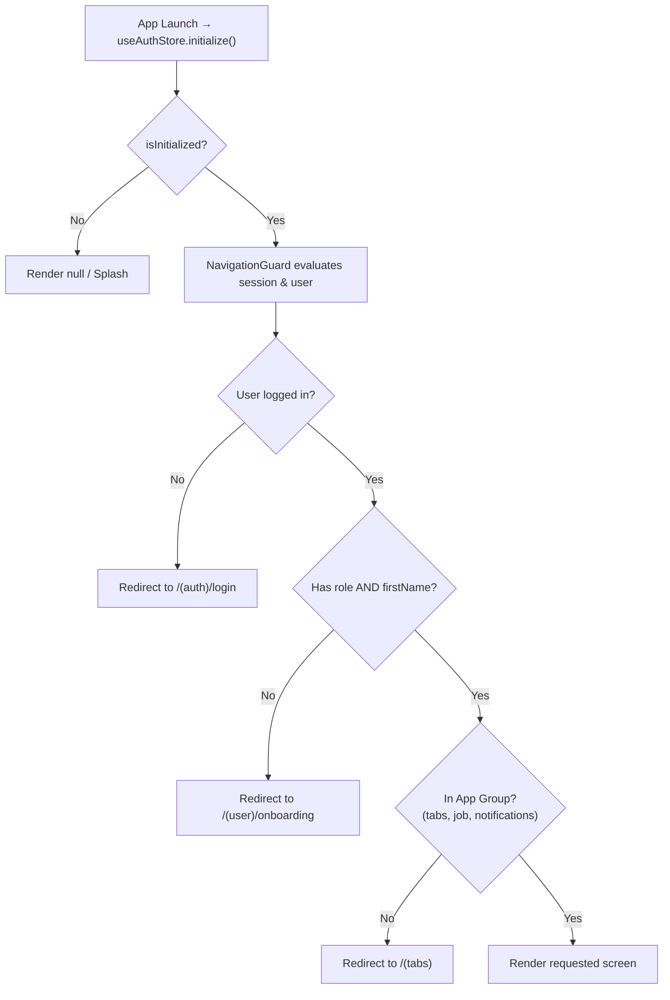

# AGENT_HANDOFF.md — ShiftLoom

> **Last updated:** 2026-10-21  
> **Source of truth:** Verified against codebase (`app/`, `src/`, `components/`) and Supabase service integrations.
>
> This document is the **single source of truth** for any AI agent picking up work on ShiftLoom.
> Read it fully before making changes. When modifying tables, screens, components, or stores, **keep this document updated**.

---

## Table of Contents

1. [Project Overview & Tech Stack](#1-project-overview--tech-stack)
2. [Supabase Database Architecture](#2-supabase-database-architecture)
   - [Actual Tables & Schema](#actual-tables--schema)
   - [Foreign Keys & Constraints](#foreign-keys--constraints)
   - [Row-Level Security (RLS) Policies](#row-level-security-rls-policies)
3. [State Management (Zustand Stores)](#3-state-management-zustand-stores)
   - [Auth Store (`useAuthStore`)](#auth-store-useauthstore)
   - [Job Store (`useJobStore`)](#job-store-usejobstore)
4. [Database Service Layer (`src/services/`)](#4-database-service-layer-srcservices)
   - [`userService.ts`](#userservicets)
   - [`jobService.ts`](#jobservicets)
5. [Components Catalog](#5-components-catalog)
   - [Application Components (`components/`)](#application-components-components)
   - [UI Components (`components/ui/`)](#ui-components-componentsui)
6. [Screens & Navigation (`app/`)](#6-screens--navigation-app)
   - [Route Tree](#route-tree)
   - [Navigation Guard & Auth Flow](#navigation-guard--auth-flow)
   - [Screen-to-Component Mapping](#screen-to-component-mapping)
7. [Core Business Logic & Rules](#7-core-business-logic--rules)
8. [Environment & Configuration](#8-environment--configuration)

---

## 1. Project Overview & Tech Stack

ShiftLoom is a shift-based job management marketplace connecting businesses with hourly workers across fixed roles (**Steward**, **Chef**, **Driver**). Workers view jobs matching their role, accept shifts, save shifts for later, and manage their accepted/cancelled shifts.

| Layer | Choice | Notes |
|---|---|---|
| **Framework** | Expo SDK 54 (managed workflow) | React Native 0.81.5, React 19.1.0 |
| **Routing** | Expo Router 6 (file-based) | Dynamic routes, tabs, modals, navigation guards |
| **Styling** | NativeWind v4 + Tailwind CSS 3 | `className` utility classes, plus standard `StyleSheet.create` where interop isolation is required |
| **State** | Zustand 5 | `useAuthStore` and `useJobStore` (No Redux, React Context, or TanStack Query) |
| **Backend / DB** | Supabase (PostgreSQL + Auth + Storage) | Supabase client via `src/lib/supabase.ts` |
| **Package Manager** | npm | **Strictly npm only** (never yarn or pnpm) |

---

## 2. Supabase Database Architecture

The application operates against four primary tables in public schema: `users`, `jobs`, `job_roles`, `user_jobs`, and `saved_jobs`.

### Actual Tables & Schema

#### 1. `users`
Worker profiles linked 1:1 with Supabase `auth.users`.

| Column | Type | Constraints / Defaults | Description |
|---|---|---|---|
| `id` | `uuid` | **PK**, references `auth.users(id)` ON DELETE CASCADE | User ID matching auth ID |
| `email` | `text` | NOT NULL | User's registered email |
| `first_name` | `text` | NULLABLE | Worker first name |
| `last_name` | `text` | NULLABLE | Worker last name |
| `role` | `text` | CHECK: `'steward'`, `'chef'`, `'driver'` | Selected worker role |
| `verification_status` | `text` | DEFAULT `'pending'`, CHECK: `'pending'`, `'verified'`, `'rejected'` | Admin verification status |
| `created_at` | `timestamptz` | DEFAULT `now()` | Record creation timestamp |

---

#### 2. `jobs`
Shift postings created by admins / companies.

| Column | Type | Constraints / Defaults | Description |
|---|---|---|---|
| `id` | `uuid` | **PK**, DEFAULT `gen_random_uuid()` | Unique shift ID |
| `company_name` | `text` | NOT NULL | Hiring company name |
| `location_address`| `text` | NOT NULL | Physical venue / address |
| `latitude` | `double precision` | NULLABLE | Coordinate for map display |
| `longitude` | `double precision` | NULLABLE | Coordinate for map display |
| `job_date` | `date` / `text` | NOT NULL | Date of shift (`YYYY-MM-DD`) |
| `start_time` | `time` / `text` | NOT NULL | Shift start time (e.g. `17:00`) |
| `end_time` | `time` / `text` | NOT NULL | Shift end time (e.g. `20:00`) |
| `status` | `text` | CHECK: `'open'`, `'closed'`, `'completed'`, `'cancelled'` | Current job status |
| `cancel_reason` | `text` | NULLABLE | **Admin** event cancellation reason |
| `created_by` | `uuid` | NULLABLE, references `auth.users(id)` | Admin who created job |
| `created_at` | `timestamptz` | DEFAULT `now()` | Record creation timestamp |
| `updated_at` | `timestamptz` | DEFAULT `now()` | Last modified timestamp |

---

#### 3. `job_roles`
Per-role slot counts and wages for each shift. One job has multiple `job_roles`.

| Column | Type | Constraints / Defaults | Description |
|---|---|---|---|
| `id` | `uuid` | **PK**, DEFAULT `gen_random_uuid()` | Unique role slot entry |
| `job_id` | `uuid` | **FK** references `jobs(id)` ON DELETE CASCADE | Associated job |
| `role` | `text` | NOT NULL, CHECK: `'driver'`, `'steward'`, `'chef'` | Required role |
| `total_slots` | `integer` | NOT NULL, DEFAULT 1 | Total worker slots |
| `wage_inr` | `numeric` | NOT NULL | Payment per shift in INR (₹) |

---

#### 4. `user_jobs`
Job applications / accepted assignments by workers.

| Column | Type | Constraints / Defaults | Description |
|---|---|---|---|
| `id` | `uuid` | **PK**, DEFAULT `gen_random_uuid()` | Application ID |
| `job_id` | `uuid` | **FK** references `jobs(id)` ON DELETE CASCADE | Shift applied to |
| `user_id` | `uuid` | **FK** references `users(id)` ON DELETE CASCADE | Worker ID |
| `role` | `text` | NOT NULL | Role assigned for shift |
| `status` | `text` | NOT NULL, DEFAULT `'accepted'` | `'accepted'`, `'cancelled_by_user'`, `'completed'` |
| `cancel_reason` | `text` | NULLABLE | **Worker**-specific cancellation reason |
| `created_at` | `timestamptz` | DEFAULT `now()` | Application timestamp |

> **Key Business Rule:** Once `status` becomes `'cancelled_by_user'`, the row remains in `user_jobs`. Because of the unique constraint `(job_id, user_id)`, the user cannot re-apply to this same shift.

---

#### 5. `saved_jobs`
Bookmarked shifts for workers.

| Column | Type | Constraints / Defaults | Description |
|---|---|---|---|
| `id` | `uuid` | **PK**, DEFAULT `gen_random_uuid()` | Bookmark ID |
| `job_id` | `uuid` | **FK** references `jobs(id)` ON DELETE CASCADE | Saved shift |
| `user_id` | `uuid` | **FK** references `users(id)` ON DELETE CASCADE | Worker who saved |
| `created_at` | `timestamptz` | DEFAULT `now()` | Saved timestamp |

- **Unique Constraint:** `(job_id, user_id)` — prevents duplicate bookmarks.

---

### Row-Level Security (RLS) Policies

Every table has RLS **enabled**:

| Table | Policy Action | Target / Rule | Purpose |
|---|---|---|---|
| `users` | SELECT | `auth.uid() = id` (or public read for assigned rosters) | Worker views own profile |
| `users` | UPDATE | `auth.uid() = id` | Worker updates own name & role |
| `jobs` | SELECT | `true` (authenticated) | All logged-in workers can browse open jobs |
| `job_roles` | SELECT | `true` (authenticated) | Read role breakdown & wages |
| `user_jobs` | SELECT | `auth.uid() = user_id` | Worker reads their own applications |
| `user_jobs` | INSERT | `auth.uid() = user_id` | Worker applies for a shift |
| `user_jobs` | UPDATE | `auth.uid() = user_id` | Worker cancels their shift (`cancelled_by_user`) |
| `saved_jobs` | SELECT | `auth.uid() = user_id` | Worker reads their saved list |
| `saved_jobs` | INSERT | `auth.uid() = user_id` | Worker bookmarks a job |
| `saved_jobs` | DELETE | `auth.uid() = user_id` | Worker un-bookmarks a job |

---

## 3. State Management (Zustand Stores)

ShiftLoom uses **Zustand** stores located in `src/store/`.

```
                    ┌─────────────────────────┐
                    │      React Screens      │
                    └───────────┬─────────────┘
                                │ Calls store hooks
            ┌───────────────────┴───────────────────┐
            ▼                                       ▼
  ┌───────────────────┐                   ┌───────────────────┐
  │   useAuthStore    │                   │    useJobStore    │
  └─────────┬─────────┘                   └─────────┬─────────┘
            │ Calls                                 │ Calls
            ▼                                       ▼
  ┌───────────────────┐                   ┌───────────────────┐
  │    userService    │                   │    jobService     │
  └─────────┬─────────┘                   └─────────┬─────────┘
            │ Supabase Query                        │ Supabase Query
            └───────────────────┬───────────────────┘
                                ▼
                    ┌─────────────────────────┐
                    │   Supabase Client / DB  │
                    └─────────────────────────┘
```

### Auth Store (`useAuthStore`)
File: [`src/store/useAuthStore.ts`](file:///Users/shivamchandra/Projects/Learning/React-native/shiftLoom/src/store/useAuthStore.ts)

- **State:**
  - `user: User | null` — Current worker's profile (`id`, `email`, `role`, `firstName`, `lastName`, `isVerified`)
  - `session: any | null` — Active Supabase auth session
  - `isLoading: boolean` — Operation loading indicator
  - `isInitialized: boolean` — True once initial session check resolves
  - `error: string | null` — Last error message
- **Actions:**
  - `initialize()`: Reads session via `supabase.auth.getSession()`, loads DB user via `fetchUser()`, registers `supabase.auth.onAuthStateChange()` listener.
  - `login(email, password)`: Authenticates via `supabase.auth.signInWithPassword()`, sets profile in state.
  - `signup(email, password)`: Creates account via `supabase.auth.signUp()`, sets initial profile in state.
  - `loginWithOTP(email)`: Requests passwordless OTP via `supabase.auth.signInWithOtp()`.
  - `logout()`: Clears session via `supabase.auth.signOut()`, resets state.
  - `updateUserProfile(updates)`: Calls `updateUser()`, refetches profile, updates store.

### Job Store (`useJobStore`)
File: [`src/store/useJobStore.ts`](file:///Users/shivamchandra/Projects/Learning/React-native/shiftLoom/src/store/useJobStore.ts)

- **State:**
  - `jobList: Job[]` — Feed of available jobs matching worker's role
  - `userJobList: UserJob[]` — Applications/shifts accepted or cancelled by the user
  - `savedJobList: Job[]` — Full objects of saved jobs
  - `savedJobIds: string[]` — Quick lookup array of saved job IDs
  - `isLoading: boolean` — Data fetching loading state
  - `isApplying: boolean` — Shift application loading state
  - `isCancelling: boolean` — Cancellation process loading state
  - `error: string | null` — Error message
- **Actions:**
  - `getJobs(role?)`: Calls `fetchJobs(role)`, updates `jobList`.
  - `getUserJobs(userId)`: Calls `fetchUserJobs(userId)`, updates `userJobList`.
  - `applyJob(jobId, userId, role)`: Calls `applyForJob()`, then automatically syncs by re-fetching `getUserJobs(userId)`.
  - `cancelJob(jobId, userId, reason)`: Calls `cancelJobApplication()`, then syncs `getUserJobs(userId)`.
  - `getSavedJobs(userId)`: Calls `fetchSavedJobs(userId)`, updates `savedJobList` & `savedJobIds`.
  - `toggleSaveJob(job, userId)`: **Optimistic toggle** of `savedJobIds` and `savedJobList`. Calls `saveJob` or `unsaveJob`; rolls back if the network request fails.

---

## 4. Database Service Layer (`src/services/`)

All direct database queries are isolated in `src/services/`.

### `userService.ts`
File: [`src/services/userService.ts`](file:///Users/shivamchandra/Projects/Learning/React-native/shiftLoom/src/services/userService.ts)

| Function | Operation | Table | Details |
|---|---|---|---|
| `fetchUser(userId)` | SELECT | `users` | Queries `users` by `id`. Maps `first_name` → `firstName`, `verification_status === 'verified'` → `isVerified`. Returns `null` on `PGRST116` (0 rows). |
| `updateUser(userId, updates)` | UPDATE | `users` | Formats camelCase fields to snake_case (`firstName` → `first_name`, `lastName` → `last_name`, `role` → `role`) and executes `.update()`. |

### `jobService.ts`
File: [`src/services/jobService.ts`](file:///Users/shivamchandra/Projects/Learning/React-native/shiftLoom/src/services/jobService.ts)

| Function | Operation | Table(s) | Details |
|---|---|---|---|
| `formatDbJob(dbJob)` | Utility | — | Safely normalizes snake_case DB row (`job_date`, `start_time`, `wage_inr`, etc.) into typed camelCase `Job` with fallback defaults. |
| `fetchJobs(role?)` | SELECT | `jobs`, `job_roles` | Fetches jobs with inner join on `job_roles` if `role` is specified (`eq('job_roles.role', role)`). Ordered by `job_date` ASC. |
| `fetchUserJobs(currentUserId)` | SELECT | `user_jobs`, `jobs`, `job_roles` | Queries applications by `user_id`. Filters out null jobs defensively. Maps `cancel_reason`. |
| `applyForJob(jobId, userId, role)` | INSERT | `user_jobs` | Inserts row with `status: 'accepted'`. Catches PostgreSQL duplicate key error code `'23505'` and throws clean user message. |
| `cancelJobApplication(jobId, userId, reason)` | UPDATE | `user_jobs` | Updates `status: 'cancelled_by_user'` and `cancel_reason: reason` where `job_id = jobId` and `user_id = userId`. Throws if RLS or match blocks update. |
| `fetchSavedJobs(userId)` | SELECT | `saved_jobs`, `jobs`, `job_roles` | Fetches saved shifts for worker ordered by `created_at` DESC. |
| `saveJob(jobId, userId)` | INSERT | `saved_jobs` | Inserts bookmark. Ignores error `'23505'` if already saved. |
| `unsaveJob(jobId, userId)` | DELETE | `saved_jobs` | Deletes bookmark matching `job_id` and `user_id`. |

---

## 5. Components Catalog

All components live at the project root under `components/` (path alias `@/components/...`).

### Application Components (`components/`)

#### 1. `JobCard`
File: [`components/JobCard.tsx`](file:///Users/shivamchandra/Projects/Learning/React-native/shiftLoom/components/JobCard.tsx)
- **Props:**
  - `companyName: string`
  - `location: string`
  - `wage: number | string` (formatted with `₹` symbol)
  - `createdAt: string` (formatted relative time, e.g. "2 hrs ago")
  - `logoUrl?: string`
  - `isSaved?: boolean`
  - `onSaveToggle?: () => void`
  - `onPress?: () => void`
  - `className?: string`
- **Description:** Primary shift card used across feeds. Displays company details, wage per shift, relative creation date, and optional bookmark save icon.
- **Included in:**
  - `app/(tabs)/index.tsx` (Home Screen)
  - `app/(tabs)/my shifts.tsx` (My Shifts Screen)
  - `app/(tabs)/saved.tsx` (Saved Screen)

#### 2. `HapticTab`
File: [`components/haptic-tab.tsx`](file:///Users/shivamchandra/Projects/Learning/React-native/shiftLoom/components/haptic-tab.tsx)
- **Props:** `BottomTabBarButtonProps`
- **Description:** Tab bar button utilizing `PlatformPressable` and `expo-haptics` for tactile feedback on iOS.
- **Included in:** `app/(tabs)/_layout.tsx`

---

### UI Components (`components/ui/`)

#### 3. `Button`, `PrimaryButton`, `SecondaryButton`
File: [`components/ui/button.tsx`](file:///Users/shivamchandra/Projects/Learning/React-native/shiftLoom/components/ui/button.tsx)
- **Props:** `label: string`, `onPress?: () => void`, `variant?: 'primary' | 'secondary'`, `loading?: boolean`, `disabled?: boolean`, `className?: string`
- **Description:** Material 3 pill buttons with active opacity and loading spinner.
- **Included in:**
  - `app/(auth)/login.tsx`
  - `app/(auth)/signup.tsx`
  - `app/(user)/onboarding.tsx`
  - `app/(tabs)/profile.tsx`

#### 4. `OutlinedInput`
File: [`components/ui/outlined-input.tsx`](file:///Users/shivamchandra/Projects/Learning/React-native/shiftLoom/components/ui/outlined-input.tsx)
- **Props:** `label: string`, `value: string`, `onChangeText: (t: string) => void`, `placeholder?: string`, `error?: string`, `secureTextEntry?: boolean`, `keyboardType?: string`
- **Description:** Clean Material 3 style outlined text input with floating label and inline error text.
- **Included in:**
  - `app/(auth)/login.tsx`
  - `app/(auth)/signup.tsx`
  - `app/(user)/onboarding.tsx`

#### 5. `Dropdown`
File: [`components/ui/dropdown.tsx`](file:///Users/shivamchandra/Projects/Learning/React-native/shiftLoom/components/ui/dropdown.tsx)
- **Props:** `label: string`, `value: string`, `options: DropdownOption[]`, `onSelect: (v: string) => void`, `placeholder?: string`, `error?: string`
- **Description:** Input-like trigger that presents a modal bottom sheet with option selections.
- **Included in:**
  - `app/(user)/onboarding.tsx` (Role selection: Steward, Chef, Driver)

#### 6. `SearchBar`
File: [`components/ui/search-bar.tsx`](file:///Users/shivamchandra/Projects/Learning/React-native/shiftLoom/components/ui/search-bar.tsx)
- **Props:** `value: string`, `onChangeText: (t: string) => void`, `placeholder?: string`, `onBackPress?: () => void`, `className?: string`
- **Description:** Rounded pill search bar with active borders, search icon, and clear button.

---

## 6. Screens & Navigation (`app/`)

### Route Tree

```
app/
├── _layout.tsx                     # Root layout, ThemeProvider, NavigationGuard
├── (auth)/
│   ├── _layout.tsx                 # Stack layout
│   ├── login.tsx                   # Email/password & OTP login
│   └── signup.tsx                  # Registration screen
├── (user)/
│   └── onboarding.tsx              # First-time profile setup (Name + Role)
├── (tabs)/
│   ├── _layout.tsx                 # Bottom tab bar (Home, My Shifts, Saved, Profile)
│   ├── index.tsx                   # Home: verification banner, available shifts
│   ├── my shifts.tsx               # Filterable tabs: Accepted, Completed, Cancelled
│   ├── saved.tsx                   # Saved / bookmarked shifts
│   └── profile.tsx                 # Profile details & logout
├── job/
│   └── [id].tsx                    # Shift detail, MapView, Apply & 2-step Cancel modal
├── notifications.tsx               # Notifications list placeholder
└── modal.tsx                       # Default Expo modal template
```

### Navigation Guard & Auth Flow
Defined in `app/_layout.tsx`:



> [!IMPORTANT]
> If you add a new top-level screen outside `(tabs)`, you **must** update the `inAppGroup` condition in `app/_layout.tsx`:
> ```typescript
> const inAppGroup = segments[0] === '(tabs)' || segments[0] === 'job' || segments[0] === 'notifications';
> ```
> Otherwise, `NavigationGuard` will redirect the user back to `(tabs)`.

### Screen-to-Component Mapping

| Screen File | Components Used | Stores / State Accessed | Database Queries Triggered |
|---|---|---|---|
| `app/(auth)/login.tsx` | `OutlinedInput`, `PrimaryButton`, `SecondaryButton`, `KeyboardAwareScrollView` | `useAuthStore` (`login`, `loginWithOTP`, `isLoading`, `error`) | `signInWithPassword` or `signInWithOtp` |
| `app/(auth)/signup.tsx` | `OutlinedInput`, `PrimaryButton`, `SecondaryButton`, `KeyboardAwareScrollView` | `useAuthStore` (`signup`, `isLoading`, `error`) | `signUp` |
| `app/(user)/onboarding.tsx` | `OutlinedInput`, `Dropdown`, `PrimaryButton`, `KeyboardAwareScrollView` | `useAuthStore` (`updateUserProfile`, `isLoading`) | `updateUser` → `fetchUser` |
| `app/(tabs)/index.tsx` | `JobCard`, `ScrollView`, `FlatList` | `useAuthStore` (`user`), `useJobStore` (`jobList`, `getJobs`, `getSavedJobs`, `savedJobIds`, `toggleSaveJob`) | `fetchJobs(user.role)`, `fetchSavedJobs(user.id)`, `saveJob`, `unsaveJob` |
| `app/(tabs)/my shifts.tsx` | `JobCard`, `FlatList`, `TouchableOpacity` | `useAuthStore` (`user`), `useJobStore` (`userJobList`, `getUserJobs`, `isLoading`) | `fetchUserJobs(user.id)` |
| `app/(tabs)/saved.tsx` | `JobCard`, `FlatList` | `useAuthStore` (`user`), `useJobStore` (`savedJobList`, `getSavedJobs`, `toggleSaveJob`) | `fetchSavedJobs(user.id)`, `unsaveJob` |
| `app/(tabs)/profile.tsx` | `Button`, `ScrollView` | `useAuthStore` (`user`, `logout`, `isLoading`) | `signOut` |
| `app/job/[id].tsx` | `MapView`, `Marker`, `Modal`, `TextInput`, `Pressable`, `ScrollView` | `useAuthStore` (`user`), `useJobStore` (`jobList`, `userJobList`, `applyJob`, `cancelJob`, `savedJobIds`, `toggleSaveJob`) | `applyForJob`, `cancelJobApplication`, `saveJob`, `unsaveJob` |

---

## 7. Core Business Logic & Rules

### 1. Shift Cancellation 2-Day Rule
- Located in `app/job/[id].tsx` (`canCancelShift(jobDateStr)`):
  ```typescript
  const diffTime = jobDate.getTime() - today.getTime();
  const diffDays = Math.round(diffTime / (1000 * 60 * 60 * 24));
  return diffDays > 2;
  ```
- **Rule:** A shift can **only** be cancelled if the start date is strictly **more than 2 days** away.
- **Example:** If today is October 12, a shift on October 14 **cannot** be cancelled (only 2 days away). A shift on October 15 **can** be cancelled (3 days away).

### 2. Two-Step Cancellation Modal & Reasons
- Tapping "Cancel Shift" prompts a modal with preset industry reasons:
  1. `Medical / Personal Emergency`
  2. `Transportation Issue`
  3. `Schedule Conflict`
  4. `Other` (reveals multiline `TextInput` for custom text)
- Saved in `user_jobs.cancel_reason`.
- Once cancelled:
  - `user_jobs.status` becomes `'cancelled_by_user'`.
  - The job detail button permanently displays `"Shift Cancelled"` and is disabled.
  - The worker **cannot** re-apply to that same shift.

### 3. Role-Based Shift Feed
- Workers **only see shifts that offer slots for their selected role** (`user.role`).
- Triggered on home mount via `getJobs(user.role)`.
- Backend enforces this using inner join: `.select("*, job_roles!inner(*)").eq("job_roles.role", role)`.

### 4. Segmented Filter Tabs in "My Shifts"
- Filter tabs: **Accepted** | **Completed** | **Cancelled**
- Status mapping:
  - `accepted`: `item.status === 'accepted'` and job not completed/cancelled.
  - `completed`: `item.status === 'completed' || item.job?.status === 'completed'`.
  - `cancelled_by_user`: `item.status === 'cancelled_by_user' || item.status === 'cancelled' || item.job?.status === 'cancelled'`.
- Styled using pure `StyleSheet.create` (`tabStyles`) to avoid NativeWind touch responder conflicts.

---

## 8. Environment & Configuration

- **Environment variables:** Configured in `.env.local`
  - `EXPO_PUBLIC_SUPABASE_URL`
  - `EXPO_PUBLIC_SUPABASE_ANON_KEY`
- **Commands:**
  - Start development: `npx expo start`
  - Start with clean cache: `npx expo start -c`
  - Run type checks: `npx tsc --noEmit`
  - Lint: `npm run lint`
- **Dependencies rule:** Always install native libraries using `npx expo install <package>` to resolve SDK 54 matching versions. Pure dev dependencies: `npm install -D <package>`. Never use yarn or pnpm.
